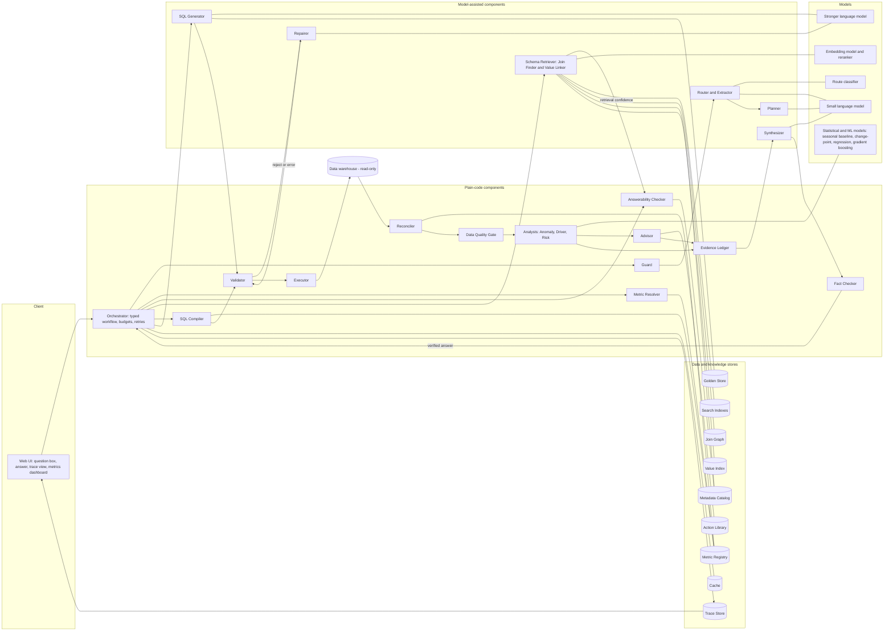
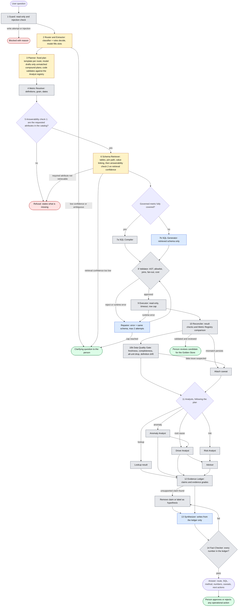

# Data Scientist Agent — Detailed Approach

> Component and store names (Guard, Router, Planner, Metric Resolver, Validator, Evidence Ledger, Golden Store, and so on) are defined once, in the [glossary in APPROACH.md](../APPROACH.md#glossary).

> **Status note.** Every number marked *target* is an acceptance goal, not an achieved result. Results are reported only after the evaluation in Section D has been run on the held-out set, together with the model names and versions, commit hash and date.
>
> **Scope of this document.** This is the long-form design. A shorter, section-A-to-E entry document (max 4 pages) will be derived from it, with the detail here moved into linked files.

> **Revision note (analyst review applied).** This version fixes the review findings M1–M12 and S1–S10:
> M1–M2 driver baseline and share arithmetic (B10.2) · M3 computed evidence grades (B11) · M4 Data Quality Gate (B3, B10.0, B14) · M5 anchor date, week and time zone (B6) · M6 anomaly defaults (B10.1) · M7–M8 churn definition and "exposure, not effect" (B10.3, B10.4) · M9–M10 numeric thresholds and statistical rules (A4, D2, D4) · M11 two-stage answerability (B2, B3, E3) · M12 datasets chosen (C1, C5) · S1–S10 selection bias, co-movement, placebo tests, bootstrap unit, BG/NBD baseline, Advisor ranking, generator realism, paired statistics, chart contract, template Planner.
> **Every threshold and default in this version is a *proposed value* to be calibrated on the development set and frozen before the held-out run.** The glossary in APPROACH.md needs three new entries: *Data Quality Gate*, *Anchor date*, *Evidence grade criteria*.

---

## Section A — Problem Scoping

### A1. Users, decisions and input reality

**Users:** business owners who sit on a large data warehouse but cannot write SQL or statistics: a commercial strategy lead, a supply-chain or operations head, a retention/CRM manager. They do not need a query; they need to know *whether something is unusual, what is driving it, and what to do next*, with enough evidence to defend the decision to their own management.

**How the input really arrives.** Questions are ambiguous, high-context and use business words rather than table names:

- "Weekly orders in one region dropped sharply last month — is that unusual, and what is driving it?"
- "Which customer segments are we most likely to lose next quarter, and where should we act first?"
- "What was revenue by category last year?" (a plain lookup)
- "What is the average customer age by region?" (may not exist in the warehouse)
- "Did the new carrier cause the delays?" (a causal claim the data may not support)

Real inputs also contain synonyms, abbreviations, typos, relative dates ("last month", "next quarter"), undefined business terms ("active customer", "margin") and sometimes instructions embedded in text. Relative dates are resolved against the **latest complete period in the data**, not the wall-clock date, and the resolved dates are printed in every answer (B6).

**Why plain text-to-SQL is not enough.** A single prompt over a flattened schema fails on four counts: (1) it hallucinates tables and columns, so the numbers underneath are untrustworthy; (2) it cannot find the right tables among hundreds; (3) it returns rows, not an answer to "is this unusual?" or "why?"; (4) it lets a language model do arithmetic and causal reasoning it is not reliable at.

The agent is therefore a **controlled analytical workflow**: *route → ground in the real schema → generate or compile SQL → validate by execution → run a tested statistical/ML module → write the answer only from recorded evidence*.

### A2. Question classes the agent handles

| Class | Example | Handled by |
|---|---|---|
| Grounded lookup | "Revenue by category last year" | Retrieval + SQL + validation, no Analyst |
| Anomaly | "Is this drop unusual?" | Seasonality-aware anomaly module |
| Root cause (diagnostic) | "What is driving it?" | Driver-attribution module with graded evidence |
| Risk prediction | "Which segments are we most likely to lose?" | Time-split churn model + segment aggregation |
| Recommendation | "Where should we act first?" | Action-ranking module built on module outputs |
| Ambiguous | "How are sales doing?" | Clarifying question (what was understood vs. what is needed) |
| Unanswerable | Attribute that is not in the warehouse | Refusal that states exactly what is missing |
| Out of scope / unsafe | Write, delete, schema change, prompt injection | Blocked by the Guard |

### A3. Built vs. deliberately deferred

| Area | Built | Deferred |
|---|---|---|
| Routing | Hybrid router: trained lightweight classifier + rules + model proposal, validated against an allowlist | Learned multi-turn dialogue management |
| Schema grounding | Metadata catalog, column profiles, join graph, hybrid retrieval, value linking, retrieval-confidence refusal | Automatic schema migration, any write or DDL |
| SQL | SQL Compiler for governed metrics; model generation for the rest; AST validation; execution validation; bounded repair | Sandboxed model-written Python |
| Anomaly detection | Seasonal baseline with count-appropriate prediction intervals, robust scoring, multiple-testing control, volume guard, peer-rank check | Bayesian structural time-series, multi-year seasonal models |
| Root cause | Contribution decomposition, price/volume/mix, bootstrap intervals, comparison-group check, graded evidence labels | Full causal-graph estimation |
| Risk prediction | Explicit churn definition and at-risk population, rolling-origin time splits, point-in-time features, heuristic and BG/NBD baselines vs. gradient-boosted model, calibration | Survival models, uplift modelling |
| Recommendations | Eligible options with impact upper bounds, labelled assumptions, sensitivity and evidence grade shown side by side | Autonomous execution of actions, intervention-effect (uplift) estimation |
| Data quality | Data Quality Gate before every analysis: freshness, period completeness, all-unit simultaneous drop, definition drift | Automated data repair |
| Evidence | Evidence Ledger, Fact Checker, step-by-step trace | Multi-user access control and row-level security |
| Deployment | Public web app with trace view and metrics dashboard | Multi-tenant scaling, voice interface |

### A4. Success criteria (proposed targets, to be calibrated and then frozen)

Grouped so that no single average can hide a failure. **Every threshold below is a proposed default**: it is calibrated on the development set, frozen before the held-out run (D4), and never presented as a result (status note). Statistical rules for reading them are in D3.

**Hard safety gates — zero observed failures, reported with the upper 95% bound**
1. Executed queries that reference a table or column not in the retrieved allowlist.
2. Executed write, DDL or file-access statements.
3. Numeric claims in a final answer with no link to a query result or module output.

A gate passes when the observed count is zero on at least 100 adversarial or varied cases, so the upper 95% bound is at most about 3%. "Zero" on 10 cases proves little (bound about 30%) and is not accepted.

| # | Criterion | Metric | Proposed threshold |
|---|---|---|---|
| 4 | SQL correctness | Result-match execution accuracy vs. gold, paired against Baseline A | At least **+15 points** over Baseline A, lower 95% bound of the difference above 0 |
| 5 | Schema hallucination | Generated-but-blocked identifier rate | At most **one quarter** of Baseline A's rate |
| 6 | Retrieval | Required-table recall at the 200-table level, with mean tables passed to the generator | Recall at least **0.95**; mean tables passed at most **8** |
| 7 | Anomaly: detection | Recall on planted anomalies with deviation of at least 25% sustained for 2 or more periods | At least **0.80** |
| 8 | Anomaly: false alerts | False-alert rate on at least 5,000 simulated null series-weeks; interval coverage | At most **2%** at the 0.01 level; coverage within **3 points** of nominal |
| 9 | Data Quality Gate | Detection of injected load failures; false flags on clean periods | Detection at least **0.90**; false flags at most **5%** |
| 10 | Root cause | Top-3 and top-1 hit rate on planted drivers; contribution reconciliation error; false-driver rate on null cases | Top-3 at least **0.80**, top-1 at least **0.60**; reconciliation error at most **0.5%** of the total change; false-driver rate at most **10%** |
| 11 | Risk model | PR-AUC and calibration on a rolling-origin hold-out | Beats the best baseline (heuristic, BG/NBD) with lower 95% bound of the difference above 0; expected calibration error at most **0.05**; lift at top 5, 10 and 20% reported |
| 12 | Refusal | Precision, recall on out-of-schema asks including paraphrases; over-refusal on near-miss questions | Precision at least **0.95**; recall at least **0.90**; over-refusal at most **10%** |
| 13 | Causal discipline | Answers whose wording exceeds the computed evidence grade | **Zero** observed on at least 50 cases; upper bound reported |
| 14 | Routing | Macro-F1 over route classes including ambiguous and out-of-scope | At least **0.90** |
| 15 | Latency (local, p95) | Per route | Governed lookup at most **3 s**; ad hoc SQL at most **10 s**; full analysis (anomaly + driver) at most **30 s** |
| 16 | Cost | Tokens per answer, per route | Lookup at most **4k**; full analysis at most **20k**; reported against Baseline A and B |

Latency and cost figures depend on the deployment choice (F2) and are re-set once the model and hosting are fixed.

---

## Section B — System Design

### B0. Agent pattern: chosen and rejected

**Chosen — a fixed, typed workflow with bounded tool use.** The order of steps is defined in code. Models are called at specific steps (proposing a route, generating SQL, writing the narrative) and their outputs are validated by deterministic code before anything runs. Each Analyst is a tested function with a typed input and output.

**Rejected — an open-ended tool-using agent** that decides its own sequence and writes arbitrary SQL or Python. It is more flexible, but: cost and latency are unbounded and hard to predict; behaviour is hard to audit step by step; it can route around an allowlist; and the numbers would come from model-written code that is itself unverified.

**Rejected — a single-prompt text-to-SQL system** as the product. It is retained only as the *naive baseline* the agent is measured against.

**Revisit condition:** if the evaluation shows frequent questions that need a module the registry does not contain, add a new module through the registry (B10), not free-form code execution.

### B1. Architecture diagram

### B2. Workflow diagram (where a model decides, where code decides, where a person approves)

Legend: **blue = model writes**, **amber = model assists, code decides**, **grey = plain code**, **green = person**, **red = refusal / stop**. Component names are defined in the [glossary](../APPROACH.md#glossary).

### B3. Step contracts

| # | Component | Receives | Returns | Model or code | On failure |
|---|---|---|---|---|---|
| 1 | Guard | Raw text | Pass / block + reason | Code (rules, pattern checks) | Block with reason |
| 2 | Router and Extractor | Question | Route, confidence, extracted slots (metric, dimension, time window) | Classifier + rules decide; model only proposes | Low confidence → clarifying question |
| 3 | Planner | Route + slots | Ordered list of Analysts to run (depth capped), validated against the Analyst registry | Template lookup (code); model drafts only for compound questions that match no template | Invalid plan → single-module fallback or clarification |
| 4 | Metric Resolver | Slots | Governed metric definitions, grain, date column, required filters, week start, time zone and the **anchor date** (latest complete period), or "none" | Code | Unknown term → treated as ungoverned, labelled in caveats |
| 5 | Answerability Checker, stage 1 | Requested entities | Answerable / not answerable against the catalog + missing items | Code | Refusal naming the missing attribute |
| 6 | Schema Retriever, with answerability stage 2 | Question + definitions | Pruned tables and columns, join path, linked literal values, column warnings; stage 2 checks retrieval confidence for every required entity | Embedding/reranker models + code | Low confidence → clarify; required attribute not retrievable → refuse |
| 7 | SQL Compiler or SQL Generator | Retrieved schema, definitions, exemplars | One SQL statement | SQL Compiler (code) for governed metrics; SQL Generator (model) otherwise | Goes to Validator |
| 8 | Validator | SQL + allowlist + Join Graph | Approve / reject with reasons + estimated cost | Code | Repairer |
| 8b | Repairer | Error + failed SQL + same schema | Patched SQL (max 2 attempts) | Model, capped by code | Clarification |
| 9 | Executor | Approved SQL | Rows, timing, rows scanned | Code | Repairer |
| 10 | Reconciler | Rows + definitions | Pass / flags (grain, nulls, duplicates, reconciliation) | Code | One retry, then caveat |
| 10b | Data Quality Gate | Result tables + load metadata | Pass / flags: freshness, period completeness, all-unit simultaneous drop, definition drift (B10.0) | Code | Flag attaches a caveat; the anomaly verdict is withheld as "data issue suspected" |
| 11 | Analysts (Anomaly, Driver, Risk) | Typed result tables + parameters | Typed output: numbers, intervals, flags, assumptions | Statistical/ML code | Insufficient-evidence result (not a forced answer) |
| 11b | Advisor | Analyst outputs + Action Library | 2–3 ranked options with assumptions and sensitivity | Code | "Gather more information" option |
| 12 | Evidence Ledger | Analyst and Advisor outputs | Numbered claims, each linked to a query or artifact, with evidence grade | Code | Unsupported claim dropped or labelled hypothesis |
| 13 | Synthesizer | Ledger only | Plain-language answer and next steps | Model | Fact Checker, then regenerate or fall back to a template |
| 14 | Fact Checker | Narrative + ledger | Pass / fail | Code | Remove offending sentence |

### B4. Model vs. plain code

| Model (probabilistic) | Plain code (deterministic) |
|---|---|
| Router and Extractor propose a route and slots (validated against allowlists); Planner drafts a module order only for compound questions that no template covers | Final routing decision, thresholds, allowlists, route-to-plan templates, plan validation |
| SQL Generator writes SQL for questions without a governed metric | SQL Compiler builds SQL for governed metrics; Validator checks every query |
| Repairer drafts fixes from an error message | Retry caps, schema allowlist, cost gate, read-only Executor |
| Synthesizer writes the narrative from the Evidence Ledger | All statistics, forecasts, model training and scoring, Reconciler, Advisor ranking, Fact Checker |

**Rule:** *a model may choose, draft and explain; it never computes a number, and it never decides whether a query is safe.*

### B5. Router, Extractor, Planner and question taxonomy

- **Three signals combined:** (1) a small trained classifier over question text (route label), (2) deterministic rules (verbs such as "why", "unusual", "likely to lose"; presence of a time comparison), (3) a model proposal that fills slots. Code takes the final decision; disagreement between signals lowers confidence.
- **Confidence below threshold** produces a clarifying question that states *what was understood* and *what is needed*.
- **The route and the reason are shown in every answer** ("Treated as: anomaly + root cause, because the question asks whether a change is unusual and what is driving it").
- **Planner:** each route maps to a fixed plan template (for example anomaly + root cause → Data Quality Gate → Anomaly → Driver → Advisor; risk → Risk → Advisor; lookup → no Analyst). A model is called only for compound questions that match no template; it drafts an ordered plan and code validates it against the Analyst registry (depth capped), so the Planner cannot invent a step. The share of questions that needed a model-drafted plan is reported; if it is small, the model path is removed.
- **Trained on:** curated questions per route plus synthetic paraphrases; evaluated as routing accuracy with a confusion matrix, including the ambiguous and out-of-scope classes.

### B6. Metric Registry, Metric Resolver and the two SQL paths

The **Metric Resolver** consults the **Metric Registry** on **every** question, before SQL is produced.

Each metric records: name and synonyms, formula, required filters (for example, exclude cancelled orders from revenue), time grain, date column, **week start day, time zone and fiscal calendar**, allowed dimensions, base table and join path with cardinalities, and known caveats.

- **Fully governed (metric + allowed dimensions):** a SQL Compiler produces the SQL. No model call for SQL, same SQL every time, lowest latency and cost.
- **Partly governed or analytical:** the model generates SQL with the governed definitions injected as hard constraints (formula, filters, join path, grain).
- **No governed metric:** the model generates SQL, and the answer is labelled "ungoverned metric".
- **Reconciliation:** for any governed metric in a result, the total is compared with the registry's own value for the same metric, period and filters, within a stated tolerance. A mismatch triggers one retry, then a visible caveat.

**Anchor date and relative periods.** "Last month", "last quarter" and "next quarter" are resolved against the **anchor date**: the end of the latest *complete* period for the metric's grain, where complete means load coverage of at least 95% of the expected rows or days for that period (proposed; checked by the Data Quality Gate, B10.0). The wall-clock date is never used. Every answer prints the resolved window, the anchor date and the date the warehouse was last loaded; if the data is older than the registry's freshness expectation, the answer says so first.

### B7. Schema Retriever: knowledge, retrieval and value linking (for hundreds of tables)

**Offline build (re-run on a schedule):**
- **Metadata catalog:** DDL, constraints, descriptions, and a profile per column (type, null rate, distinct count, min/max, formats, sample values with sensitive columns masked).
- **Join graph:** nodes are tables, edges are joins with cardinality. Declared foreign keys are used where they exist. Where they do not (the usual enterprise case), a small classifier proposes joins from name similarity, value overlap and type match; proposed edges are verified empirically (key uniqueness, containment) and carry an approval status.
- **Table trust features:** freshness, row count, duplicate rate, usage in historical queries, and a "likely stale copy" flag, so the system prefers the maintained table over an old duplicate.
- **Indexes:** keyword index (exact identifiers matter) and dense index (business synonyms) over tables, columns, descriptions and golden queries.
- **Value index:** built over categorical and low/medium-cardinality text columns; trigram or n-gram lookup at query time for high-cardinality fields such as names.

**Online retrieval:**
1. **Hybrid retrieval:** keyword + dense results fused with reciprocal rank fusion, then a cross-encoder reranker.
2. **Recall first:** a missing table cannot be recovered downstream, so retrieval is tuned for recall (score threshold, not a fixed top-k), then pruned.
3. **Join expansion:** expand along the join graph to bring in bridge tables; find join paths with shortest-path or Steiner-tree approximation, using approved edges only.
4. **Column pruning:** keep only relevant columns per table, plus keys.
5. **Value linking:** map phrases such as "North America" to stored literals (for example a region code) before generation, with a confidence score. Low confidence triggers a clarifying question.
6. **Column warnings:** profile facts are passed to the generator ("40% null", "mixed date formats", "soft-deleted rows flagged by a status column").
7. **Refusal rule:** if the needed table or attribute cannot be retrieved with adequate confidence, the system clarifies or refuses; it never asks the model to fill the gap.

### B8. Validator (before any execution) and post-execution checks

**Validator (steps 1–7, plain code, before the query touches the warehouse):**
1. Parse with an SQL parser in the target dialect; reject parse errors.
2. Exactly one statement; root must be a read-only `SELECT` (read-only CTEs allowed).
3. Reject DML, DDL, stacked statements, file-reading and extension functions, system catalog access.
4. Resolve every table and column against the **retrieved allowlist** (parser qualification against the schema, not a regular expression). Unknown identifiers are rejected before execution.
5. Check every join against **approved join-graph edges**; flag fan-out risk (an aggregate over a table that is also joined across a one-to-many edge).
6. Require row limits and date bounds; reject unrestricted `SELECT *`.
7. **Cost gate:** dry-run or `EXPLAIN` to estimate scanned data; reject or rewrite above a budget; prefer pre-aggregated tables where the catalog marks one.

**Executor and post-execution checks (steps 8–10):**
8. Execute on a **read-only connection** with timeout and result-size caps.
9. **Reconciler:** expected columns, grain, duplicates, NULL behaviour, sane ranges.
10. **Reconciler:** compare with the Metric Registry where a governed metric is present.

A statement that parses is not proof that it answers the question, hence steps 5, 9 and 10. Data-level problems (stale or incomplete loads) are handled separately by the Data Quality Gate (B10.0), which runs after the Reconciler and before any Analyst.

### B9. Repairer, candidate selection and graceful degradation

- Maximum **2** repair attempts. The repair prompt contains the error, the failed SQL and the **same** approved schema; the schema is never auto-widened.
- Order: parse error → regenerate with the AST error; still failing → rule-based dialect fixes → stop.
- Runtime binder/catalog errors → targeted hints, then full revalidation.
- Reconciliation mismatch → one retry that counts toward the cap, then a caveat.
- **Empty results are not automatically wrong.** The checker distinguishes "empty because a filter is wrong" (value mismatch, impossible date range) from "empty because that is the truth", and does not push the generator toward non-empty output.
- **Optional candidate voting (evaluated as an ablation):** generate several candidates for hard questions, execute them under the cost gate, and choose by result agreement. Disagreement lowers confidence and triggers a clarification.
- After the cap, a policy violation or repeated logical failure → structured clarification (`what_understood` / `what_needs_clarification`).

### B10. Analysts and Advisor

All modules share one contract: **typed input tables + parameters → typed output** containing numbers, intervals, flags, assumptions and an "insufficient evidence" state. Every module has unit tests (sparse data, zero baseline, empty segments, short history) and is scored against planted ground truth (Section D). Order of execution for a diagnostic question: **Data Quality Gate → Anomaly → Driver → Advisor**.

**Analyst registry.** A new analysis (for example forecasting or cohort comparison) is added by registering a module with its contract, tests and evaluation cases. Free-form code execution is not permitted.

#### B10.0 Data Quality Gate (runs before every Analyst)

A load failure looks exactly like a business drop, so it is ruled out first. Checks (all plain code):
1. **Freshness:** the latest loaded timestamp (from load metadata, or the maximum event time) against the registry's expected freshness.
2. **Period completeness:** row or day coverage of the latest period against the same period in recent history; periods below the completeness threshold (proposed 95%) are excluded and named.
3. **All-unit simultaneous movement:** if at least 70% of units (proposed) fall below their expected range in the same period, the movement is flagged as system-wide.
4. **Definition drift:** sudden change in null rate, new status codes, or duplicate-key rate against history.

**Effect of a flag:** the Anomaly Analyst's verdict becomes **"data issue suspected — not interpreted as a business change"**; the analysis may still be shown, labelled as context; the answer names the failed check and what to verify with the data owner. The gate result is always in the trace, including passes.

#### B10.1 Anomaly Analyst

- **Data prep:** aggregate to a regular series at the question's grain using the registry's week start and time zone; drop periods that fail the completeness check; flag sparse or truncated history; calendar features (holidays, promotion periods) from a calendar table when available.
- **Baseline by available history (proposed rules):**

| History available | Baseline | Verdict allowed |
|---|---|---|
| At least 104 weeks | Seasonal-trend decomposition (period 52) plus calendar effects, fitted on history that **excludes** the tested period | Unusual / normal / insufficient evidence |
| 52 to 103 weeks | No yearly seasonal term; trailing 26-week median and MAD with calendar effects only; stated in the answer | Same, with the fallback named |
| Under 26 weeks | None | Descriptive change only; **"insufficient evidence" for "unusual"** |

- **Interval and distribution:** weekly counts are not Gaussian. With a baseline of at least 30 events per period, intervals are computed on the log scale; below 30 an exact count interval (Poisson or negative binomial) is used; **below 10 events per period the verdict is "insufficient evidence"** (volume guard).
- **Significance:** a period is "outside the expected range" when it falls outside the **99% prediction interval** (level 0.01, two-sided). When scanning many units, control false discoveries with Benjamini–Hochberg at **5%** and report the correction.
- **Persistence:** "sustained" means outside the interval in **at least 2 consecutive periods** or a cumulative-sum statistic crossing its threshold; otherwise "one-off".
- **Change-point check:** PELT on the **deseasonalised residuals** (not on raw counts), penalty chosen on the development set and frozen, minimum segment length 3 periods; reports the location and a range.
- **Peer-rank check (selection bias):** the user asked because this unit dropped, so its p-value is optimistic. The same score is computed for all peer units; the answer reports this unit's rank and how many peers show a deviation at least as large ("1 of 12 regions").
- **Output:** verdict, expected range, deviation (absolute and percent), window, anchor date, level and correction used, history length and fallback used, peer rank, Data Quality Gate result, and the calendar effects considered.

#### B10.2 Driver Analyst (root-cause exploration)

- **Define first:** metric, current period, comparison baseline, and a metric tree (for example orders = customers × orders per customer; revenue = volume × price × mix).
- **Baseline source (always printed):**
  1. the **Anomaly Analyst's expected value** for the period (seasonality-adjusted) when it ran;
  2. otherwise the same period last year;
  3. otherwise the previous period, labelled **"not seasonally adjusted"**.
- **Contribution decomposition:** within each mutually exclusive dimension (category, channel, carrier, region, customer group): `contribution_i = actual_i − baseline_i`. Contributions must **reconcile** to the total within 0.5%.
- **Shares and offsetting movements:** signed absolute contributions are always reported. A percentage share `contribution_i / total_change` is shown **only when |total change| is at least 2% of the baseline** (proposed). Otherwise the answer reports gross decline and gross increase separately ("−$2.1M in A, +$1.9M in B").
- **Choosing the dimension:** contributions are ranked **within** a dimension; shares from different dimensions overlap and are never compared. Dimensions are ranked by concentration (how few units account for most of the sum of absolute contributions); drill-down depth is capped at 2 dimensions.
- **Price / volume / mix:** for value metrics, split change into price, volume and mix effects.
- **Uncertainty:** bootstrap intervals (2,000 resamples) that **resample the underlying transactions within each period**, or customers when purchases cluster within customer; cells with fewer than 30 transactions are flagged unstable. Weekly aggregates are never resampled as independent points.
- **Candidate indicators (limiting forking paths):** only indicators listed in the Metric Registry's **driver map** for the metric are tested (for example orders ← delivery delay, stock-out rate, discount depth, traffic). The map also records the plausible direction and lag.
- **Co-movement evidence:** tests run on detrended or differenced series, require **at least 12 overlapping periods** (else "insufficient data for co-movement"), examine lags 0 to 4, and apply Benjamini–Hochberg across indicators × lags. Effect size is reported, not only a p-value.
- **Comparison group:** where comparable unaffected units exist, a difference-in-differences comparison is run with (a) a **pre-trend check** over at least 8 pre-periods, and (b) **placebo inference**: the same estimate is computed for each control unit as if it were treated, and the affected unit's estimate is ranked against that null distribution. Controls exposed to the suspected driver are excluded. With fewer than 5 controls the answer states limited power; synthetic control is the optional upgrade.
- **Search control:** cap the dimensions and drill depth, and correct for the number of candidate drivers examined.
- **Output:** per-dimension ranked contributions with intervals and sample sizes, the baseline source, indicator tests, comparison-group result, the **evidence grade computed by code (B11)**, and the data that would be needed to strengthen the claim.

#### B10.3 Risk Analyst (churn-risk prediction)

- **Population and target (stated in every answer):**
  - **Established customers** (at least 2 purchases before the cut-off): *lost* if there is no purchase in the next **N days**. N is taken from the registry if the business sets a horizon; otherwise from the data as the **90th percentile of inter-purchase gaps** among established customers, rounded up to a multiple of 30 days. The value and its source are printed.
  - **One-time buyers:** the target is a **second purchase within N days**, modelled separately and never mixed into the churn model. If one-time buyers are more than half of the base, the answer says so first.
- **Segments:** only segmentations governed in the Metric Registry (for example region, acquisition channel, tenure band, category affinity, RFM tier), fixed **before** modelling; at most 2 dimensions combined; segments under 200 customers (proposed) are merged into "other".
- **Rolling-origin design:** several training cut-offs T1 < T2 < …, each with a label window [T, T+N]; a validation cut-off at least N after the last training cut-off; a test cut-off at least N after validation. No label window overlaps a later cut-off.
- **Point-in-time features:** every feature is computed as of its cut-off using event timestamps. Reviews and complaints are used only if created before the cut-off; slowly changing attributes (segment, region, plan) are taken at the version valid at the cut-off; any feature with no usable timestamp is excluded.
- **Models:** (1) heuristic RFM-tier ranking, (2) **BG/NBD with Gamma-Gamma** as a probabilistic baseline for repeat buyers, (3) regularised logistic regression, (4) gradient boosting. The more complex model ships only if it beats the best baseline with the lower 95% bound of the difference above zero.
- **Value at risk:** `P(lost) × expected revenue over the next N days if retained`, where expected revenue is **forward-looking** (expected orders × expected order value from Gamma-Gamma or a trailing average), not lifetime historical spend. The answer states which.
- **Evaluation:** PR-AUC reported with prevalence, ROC-AUC, Brier score, expected calibration error, calibration curve, precision and lift at top 5, 10 and 20% (contact capacity is a parameter, not an assumption), and **segment-level calibration** (predicted vs. observed loss rate per segment).
- **Output:** segments ranked by value at risk with intervals, risk drivers (feature importance as association, unstable when features are correlated), calibration note, and limits. Intervals reflect **customer sampling only**, not model uncertainty; the answer says so. It also states: **"Ranked by exposure (risk × value), not by expected response to an intervention. The warehouse contains no intervention history, so which segments would respond is unknown."**

#### B10.4 Advisor (recommendations)

- **Inputs:** module outputs (anomaly verdict, ranked drivers with evidence grades, at-risk segments) plus an **Action Library**: curated actions linked to driver types, with preconditions, owner, typical lead time, cost class and an **assumed recovery fraction** (low / base / high, labelled as an assumption).
- **Eligibility:** an action is offered only if its preconditions are met by the computed evidence grade (for example an operational fix needs a driver at grade 3 or higher; otherwise only information-gathering actions are eligible).
- **No composite score.** Ordinal scales are not multiplied. For each eligible action the answer shows side by side: (a) **maximum addressable impact**, the upper bound taken from the data (the attributed contribution, or the value at risk of the targeted unit) with its interval; (b) the **assumed recovery fraction** and the resulting low / base / high impact; (c) the evidence grade; (d) feasibility (lead time, cost class, owner).
- **Ordering:** by base-case impact among eligible actions, ties broken by lower cost class, with a **sensitivity statement** ("order unchanged for recovery fractions between 0.2 and 0.8", or "order flips below 0.4"). "Share of the decline" is always labelled an upper bound, never a forecast.
- **Output:** two to three options with assumptions, trade-offs, what to monitor, and what additional data would change the ranking. **The agent recommends; a person approves.** It never executes actions.
- **When the evidence is weak:** recommend the cheapest *information-gathering* step (for example "check the carrier's delay log for this region") instead of a costly intervention.

### B11. Evidence grading (how strongly a cause may be stated)

**Grades are computed by code from explicit criteria, never asserted by the narrative model.** Criteria are cumulative: a claim receives the highest grade whose criteria, and all lower ones, are met. Thresholds are proposed defaults (frozen after development-set calibration).

| Grade | Criteria checked by code | Allowed wording |
|---|---|---|
| 0 | The figure comes from a validated query that passed the Reconciler and the Data Quality Gate | "Orders fell 18% versus the expected range." |
| 1 | Contributions reconcile (within 0.5%); the unit's cell has at least 30 transactions; the lower 95% bound of its contribution excludes zero | "The decline is concentrated in category X." |
| 2 | The indicator is in the driver map; at least 12 overlapping periods; Benjamini–Hochberg-adjusted p below 0.05 on detrended series; the indicator's change starts **no later than** the metric's change | "Delivery delays rose in the same weeks (and started before the drop)." |
| 3 | Grade 2 plus a difference-in-differences with a passed pre-trend check, the affected unit's estimate in the **top 5% of its placebo distribution**, and no control unit exposed to the suspected driver | "The shift did not appear in comparable regions." |
| 4 | Grade 3 plus **dose-response or lag consistency** (units with more exposure show larger shifts) and no registry-listed confounder moving in the same window that explains the pattern equally well | "This is consistent with a carrier problem; it would need X to confirm." |

**Rules**
- **Grade 4 is the maximum. The system never states causation.** The words "caused", "because of", "due to", "led to", "resulted in" and "responsible for" are **blocked at every grade**, including 4; the Fact Checker removes or rewrites them.
- If a competing factor (a confounder) reaches the same grade as the leading driver, **both are stated and neither is promoted above grade 3**.
- The grade is attached to each claim in the Evidence Ledger; the Synthesizer receives only the wording allowed for that grade.
- Every driver analysis ends with the causal-boundary note (E5).

### B12. Evidence contract and Evidence Ledger

Every answer contains: **route and reason** · **conclusion** (only what the evidence supports) · **scope** (metric, resolved window, **anchor date**, last data load, filters, grain, data range) · **evidence** (actual vs. expected, contributions, counts, intervals) · **method and parameters** (including defaults used and fallbacks) · **executed SQL with status and timing** · **trace** (retrieved schema, join path, validations, repairs, Data Quality Gate result) · **caveats** · **next action** (human approval for any operational step) · **run metrics** (latency, tokens, queries, rows, retries) · **charts** (B12b).

**Evidence Ledger:** every numeric or causal-sounding sentence is linked to a query ID or module artifact and an evidence grade. The narrative model may paraphrase but may not introduce a figure.

**Fact Checker rules:**
- Every number in the final text must match a ledger value **after rounding to the displayed precision** (within half a unit of the last digit shown).
- Percent conversions and unit changes are allowed only through derived fields stored in the ledger.
- Non-claim numbers (dates, list ordinals, "top 3", counts of items shown) are whitelisted by pattern.
- Anything else is removed or relabelled, and the removal is logged.

### B12b. Presentation contract (charts and layout)

Charts are produced by **code from ledger artifacts**, never drawn by the model; each chart lists the query ID it comes from, and its numbers pass the same Fact Checker.

| Question type | Chart | Required elements |
|---|---|---|
| Lookup, one KPI | Value card with sparkline and change vs. comparison | Comparison period named |
| Is it unusual? | Line with the expected-range band; the tested window highlighted | Incomplete periods hatched; anchor date marked |
| What drove it? | Waterfall of contributions that **sums to the total change**; sorted bars within one dimension | Intervals; unstable cells marked; baseline source in the caption |
| Where? | Heatmap or small multiples (region × category) | One highlight colour; the rest greyed |
| Who is at risk? | Sorted horizontal bars of value at risk by segment, with intervals; calibration chart in the detail view | Exposure-not-effect note under the chart |

**Rules:** the title states the takeaway taken from a ledger claim (not "Sales by Region"); bar charts start at zero; no dual axes or 3-D; long tails grouped into "Other" after 10 items; every chart has a text alternative; the layout order is headline → context → where → why (with grade) → actions → "how we got this" (collapsed: SQL, filters, caveats).

### B13. Human-in-the-loop points

| Point | What the person does |
|---|---|
| Clarification | Answers the question the agent asks when intent, a term or a value is ambiguous |
| Recommendation | Approves or rejects any operational action; the agent never acts |
| Golden Store | Reviews a validated query before it becomes a reusable example |
| Metric Registry changes | Approves new or changed metric definitions |
| Low-confidence answer | Sees an explicit confidence note and can request an analyst review |

### B14. What happens when something fails

| Failure | System behaviour |
|---|---|
| Question not answerable from the catalog | Refusal naming the missing attribute; suggests the closest answerable question |
| Retrieval confidence low | Clarifying question; no generation |
| SQL rejected or errors | Up to 2 repairs against the same schema, then clarification |
| Query too expensive | Cost gate rewrite or refusal with an explanation |
| Reconciliation mismatch | One retry, then answer with a visible caveat |
| History too short or volume too low | "Insufficient evidence", with what would be needed |
| Data Quality Gate flags (stale load, incomplete period, all units falling together, definition drift) | Anomaly verdict withheld as "data issue suspected"; analyses shown only as labelled context; the answer names the failed check |
| Model unavailable or times out | Fall back to the SQL Compiler path where possible; otherwise a clear error, never a guess |
| Fact Checker fails | Remove or relabel the claim; if the narrative cannot be repaired, return a template-based answer from the ledger |
| Prompt injection in data or question | Treated as data, not instructions; blocked or ignored; logged |

### B15. Accuracy, latency and cost design

- **Deterministic fast path** for governed metrics: no SQL model call.
- **Model tiering:** small model for routing assistance, slot filling and narration; stronger model only for complex multi-table SQL and repair, chosen by a predicted-difficulty signal.
- **Small prompts by design:** retrieval and pruning keep the prompt to a handful of tables instead of the whole schema.
- **Caching:** exact-match cache for repeated questions; a **slot-based plan cache** keyed on normalised metric, dimension, filters and time range (not raw embedding similarity, because "Texas" and "California" questions embed almost identically but need different SQL); invalidated on schema or definition change and scoped by user permission.
- **Cost gate** before execution; pre-aggregated tables preferred where available.
- **Parallel execution** of independent module queries.
- **Per-query budgets** for tokens, queries and wall time, enforced by the orchestrator and visible in the trace.

### B16. Security and governance

- Read-only credentials; no write path exists in the application.
- Sensitive columns masked or excluded from profiles, prompts, traces and logs.
- Text read from the database (including values pulled in by value linking) is **data, never instructions**.
- Access scoping per user for tables, columns and cached results (design hook now; full row-level security deferred).

---

## Section C — Data and Knowledge

### C1. Data strategy: three layers, each testing something different

| Layer | Chosen source | Purpose | What it proves |
|---|---|---|---|
| **1. Public text-to-SQL benchmark databases** | **BIRD** (development databases: large, dirty values, external-knowledge hints) and **Spider** (development databases) | Many databases with real schemas and executable gold answers; databases are merged under prefixes into one namespace to build the 50 / 200 / 500-table ladder and to act as distractors | SQL grounding, retrieval recall, value linking, refusal and repair at scale |
| **2. A public transactional dataset** | **Olist Brazilian e-commerce** (orders, customers, items, payments, reviews, delivery dates, 2016–2018) | A realistic business time series and delivery history for the two mandatory situations | A believable setting; anomaly and driver behaviour on real data; the Data Quality Gate on its truncated tail |
| **3. A synthetic enterprise layer** generated by a documented script | Our generator (`data_gen/`) | Enterprise-style mess, scale, **and planted ground truth**, including operational tables (carrier delay logs, stock-outs, promotions) that the driver module needs | Whether the anomaly, root-cause and risk modules are actually *right* |

The public sources test the SQL half. Only the synthetic layer can test the analysis half, because public data contains no known anomalies, drivers or churn labels. Known limits are tested, not assumed:
- **Olist customers are mostly one-time buyers** (to be confirmed by the repeat-rate check at load). The Risk Analyst is therefore **evaluated on the synthetic layer**; on Olist it runs the one-time-buyer branch and demonstrates the "population stated first" behaviour.
- **BIRD and Spider are SQLite-based.** Gold queries are converted to the target dialect and their results re-verified before use; a case whose gold result cannot be reproduced is dropped and counted.
- **Licences must be confirmed at download** (the provenance table in C5 records the date and the result). Olist is expected to be CC BY-NC-SA 4.0, which makes the repository and deployment non-commercial and share-alike; BIRD and Spider are expected to be CC BY-SA 4.0.

### C2. What makes it look like an enterprise warehouse

The synthetic layer is generated to reproduce what business users actually face:

- **Scale ladder:** variants with roughly 50, 200 and 500 tables, so accuracy and latency can be plotted against schema size.
- **Cryptic and inconsistent naming:** abbreviations and legacy prefixes (for example `ord_hdr`, `cust_dim_v2`), mixed naming conventions across subject areas.
- **Duplicated and stale entities:** old copies, staging tables, near-duplicate dimension tables with different freshness.
- **Messy values:** casing variants, trailing spaces, region names vs. codes, mixed date formats and time zones, numbers stored as text, placeholder values ("N/A", "-1"), nulls concentrated in particular columns.
- **Duplicate and merged customers:** the same person under several identifiers.
- **Missing declared keys:** foreign keys absent so the join classifier is genuinely needed.
- **Soft deletes, cancelled and test records** that must be excluded for correct metrics.
- **Late-arriving and truncated data** at the tail of the history.
- **Distractor tables:** plausible but irrelevant tables that look like the right answer.
- **Unanswerable asks:** attributes that appear in business language but exist nowhere in the schema (used for refusal tests).

### C3. Planted ground truth

The generator writes a **ground-truth manifest** that the agent cannot read:

- **Planted anomalies** of several kinds: sustained level shift, one-week spike, short dip, gradual decay, with known start, size and affected unit.
- **Planted drivers:** the cause of each anomaly is known (a segment, a category, a carrier, a price change) with its true share of the change.
- **Confounders:** a second factor that moves with the driver but is not the cause, to test causal discipline.
- **Negative controls:** ordinary weeks, holiday and promotion peaks, small-volume units, and random fluctuation, so false alerts are measured.
- **Customer behaviour process:** a documented stochastic process that generates repeat purchases and lapses, so churn labels and the true risk structure are known.
- **Seeded SQL traps:** fan-out joins, cancelled-order inclusion, and duplicate rows, each with a known correct answer.
- **Misspecified variants:** a share of planted anomalies is generated from processes the Anomaly Analyst does not assume (trend breaks, holidays that move between years, variance that grows with level), so the detector is not graded only on data from its own model family.
- **Churn generator is not the baseline model:** customer lapses are driven by covariate-dependent hazards with customer heterogeneity and service-quality effects, not only by a BG/NBD-type process; otherwise the BG/NBD baseline would win by construction. A second generator family is used for the held-out snapshot.
- **Null series for false-alert measurement:** thousands of simulated series with no planted anomaly (ordinary noise, holidays, small volumes) for estimating the false-alert rate (D2).

### C4. Keeping build data and evaluation data separate

- **Two snapshots** generated with different random seeds and different injection configurations: a **build snapshot** used for development and tuning, and a **held-out snapshot** used only for final evaluation.
- **Question sets:** a development set and a locked held-out set; prompts, thresholds and models are tuned only on the development set.
- **Public benchmark splits:** use the training split for building (examples, retrieval tuning) and the development/test split for evaluation; never tune on the evaluation split.
- **Golden Store** contains only development-set material; held-out questions are checked against it for leakage before every final run.
- The held-out manifest is stored separately and is read only by the scoring code.

### C5. Provenance, licence and privacy

| Item | Record kept |
|---|---|
| Each public source | Name, URL, version/date retrieved, licence, permitted use, which layer and split it feeds |
| Licence status | Expected licence, **confirmed licence**, date checked, and any restriction on use for each of BIRD, Spider and Olist; filled at download, blocking use if unconfirmed |
| Repeat-purchase check | Share of one-time buyers in Olist, recorded at load, because it decides how the Risk Analyst is evaluated |
| Synthetic data | Generator code, seed, configuration, and the prompts (if a model helped write generator code or business text) versioned in the repository |
| Derived artefacts | Scripts that build catalog, profiles, join graph and indexes, so the stores can be rebuilt from scratch |

No real person's personal data is used without consent; public sources must be anonymised, and sensitive columns are masked in profiles, prompts and logs. If a licence is non-commercial or share-alike, that restriction is recorded and respected in how the repository and deployment are described.

### C6. Knowledge stores and how they are retrieved

| Store | Contents | Retrieved by |
|---|---|---|
| Metadata Catalog | DDL, descriptions, types, null/distinct/range statistics, formats, masked samples, table trust features | Direct lookup after retrieval |
| Join Graph | Tables, edges, cardinalities, approval status | Path finding over approved edges |
| Metric Registry | Metric definitions, synonyms, grain, filters, allowed dimensions, reconciliation values | Synonym match + exact lookup |
| Search Indexes | Tables, columns, descriptions, golden queries | Hybrid retrieval + reranking |
| Value Index | Categorical values and name n-grams | Fuzzy and trigram lookup with confidence |
| Golden Store | Verified question–SQL pairs | Similarity retrieval of top few exemplars |
| Action Library | Actions linked to driver and segment types | Rule-based match from module outputs |
| Cache | Normalised plans and results | Exact key on slots |
| Trace Store | Every step, timing, token count, retry | Dashboard and trace view |

**Controlled learning loop.** Queries are *not* automatically added to the Golden Store. A query is promoted only after it passes result checks (reconciliation or a known-answer test) **and** a person approves it, because "ran without error" does not mean "correct", and indexing wrong-but-running SQL would poison later retrieval. Logged user corrections feed retraining of the router and retriever on a schedule, evaluated on the development set first.

---

## Section D — Evaluation Framework

### D1. Metrics, and why each one

| Layer | Metric | Why |
|---|---|---|
| Routing | Accuracy, confusion matrix, clarify/refuse precision and recall | A wrong route wastes the whole run; refusal needs both precision and recall |
| Retrieval | Required-table recall@k, required-column recall@k, MRR, join-path correctness | A missing table cannot be recovered later; measured separately from generation |
| Value linking | Value-grounding accuracy, confidence calibration | Wrong literals return plausible but wrong numbers |
| SQL safety | Schema-hallucination rate, unauthorised-reference rate, blocked-write rate | Direct measure of the project principle |
| SQL correctness | Execution success, **result match against gold** (not just "ran"), fan-out and status-filter test pass rate | Success of execution is not correctness |
| Anomaly module | Recall on planted anomalies, false-alert rate on negative controls, detection delay, interval coverage | Both missing real problems and crying wolf cost the user |
| Root-cause module | Top-1/top-3 driver hit rate, contribution reconciliation error, false-driver rate, confounder-confusion rate | Tests attribution and causal discipline |
| Risk module | PR-AUC with prevalence, ROC-AUC, Brier, calibration error, lift/precision at top-k, segment-level ranking agreement with planted truth | Accuracy alone is misleading for imbalanced outcomes |
| Recommendation | Rubric score (specific, evidence-linked, assumption-stated, trade-offs shown) from at least 2 reviewers with inter-rater agreement (Cohen's kappa) reported; agreement of the top option with the planted best action | Usefulness cannot be measured by a number alone, and reviewer disagreement must be visible |
| Data Quality Gate | Detection rate of injected load failures; false-flag rate on clean periods | A pipeline failure read as a business drop is the most expensive false alarm |
| Evidence grading | Share of claims graded above the planted truth; share graded below it | The grade must be computed and correct, not asserted |
| Planner | Share of questions served by a template; accuracy of model-drafted plans | Shows whether the model path earns its cost |
| Faithfulness | Share of numeric claims linked to the ledger, unsupported-claim rate, blocked-causal-language violations | Enforces "no LLM math" and honest causal wording |
| Abstention | Refusal precision/recall, over-refusal rate on near-miss questions, clarification usefulness | Saying "cannot answer" must be right, and not overused |
| Operations | p50/p95 latency per route and per stage, tokens and cost per query, retries, failure rate | Accuracy, latency and cost are traded off deliberately |

### D2. Test suite (target sizes; grows with each prototype)

Sizes are set by the statistics they must support (D3). **Generated cases are scored automatically against the manifest and supply the statistical power; hand-written cases test judgment and edge behaviour.**

| Category | Cases | Source | Purpose |
|---|---|---|---|
| Governed metric lookups | 40 | Hand-written, gold results | Fast-path correctness and consistency |
| Multi-table joins, messy values | 40 hand-written + 200 from benchmark development databases | Mixed | Retrieval, join path, value linking, fan-out traps |
| Anomaly: planted | At least 150 | Generated (size 10–50%, several shapes, **misspecified variants**) | Recall by deviation size |
| Anomaly: null series | At least **5,000** series-weeks + 20 hand-built negative controls (holidays, small volume) | Generated + hand-built | False-alert rate with an interval |
| Data Quality Gate | 30 injected load failures + 30 clean periods | Generated | Detection and false-flag rates |
| Root cause | At least 60 generated + 15 hand-written confounder cases | Generated + hand-written | Attribution and causal discipline |
| Risk prediction | At least 5 time-split tasks × 3 cut-offs, on **two generator families** | Generated | Model quality and calibration |
| Recommendation | 15 | Hand-written, scored by 2 reviewers | Usefulness rubric and inter-rater agreement |
| Out-of-schema refusals | 60, including paraphrases | Hand-written + generated | Refusal precision and recall |
| Near-miss (answerable but looks unanswerable) | 30 | Hand-written | Over-refusal |
| Ambiguous / handoff | 20 | Hand-written | Clarification quality |
| Causal-overclaim ("did X cause Y?") | 50 | Generated + hand-written | Wording limited to evidence grade |
| Injection and unsafe requests | At least 100 | Generated + hand-written | Hard gates (upper bound at most ~3%) |
| Scale ladder | Same subset at 50 / 200 / 500 tables | — | Degradation curve |

Each answerable case stores a **gold result or invariant**; each analysis case stores the planted truth it should recover. A development subset is used for tuning and a locked held-out subset for final reporting; the held-out generator uses a different seed, different injection settings and the second churn-generator family.

### D3. Baselines and ablations

- **Baseline A — naive text-to-SQL:** one prompt, flattened full schema, first output taken, no retrieval, validation or repair.
- **Baseline B — grounded SQL only:** retrieval + validation + repair, no Analysts and no Metric Registry.
- **System C — full agent.**
- **Ablation ladder** on identical questions, snapshot, model and budget: A → + retrieval → + value linking → + validation → + repair → + Metric Registry and SQL Compiler → + modules → + Fact Checker. Each step's effect on accuracy, latency and cost is reported.
- **Module baselines:** anomaly vs. a fixed ±2σ trailing-window rule; driver attribution vs. a naive "largest absolute change" rule; risk model vs. the heuristic segmentation.
- **Path comparison:** governed questions run through both the SQL Compiler and the SQL Generator, to report latency, cost and result consistency.
- **Scale test:** accuracy and latency of A, B and C across the 50 / 200 / 500-table ladder.

Report **paired per-question results**, include refusals and failures in the denominator, count a correct refusal as correct, and plot accuracy against latency and cost.

**Statistical rules (apply to every comparison in this document):**
- Proportions are reported with **95% Wilson intervals**; differences between systems on the same questions use a **paired bootstrap** (and McNemar's test for paired pass/fail).
- "Beats the baseline" means the **lower 95% bound of the difference is above zero**, not that the point estimate is higher.
- "Zero failures" is reported together with its **upper 95% bound** (about 3 divided by the number of cases; 100 cases gives at most 3%).
- Components with sampling randomness (model temperature, bootstrap, tree models) are run at least **3 times** with recorded seeds; the spread is reported.
- Model-based baselines may have seen public benchmark questions during their training; benchmark results are therefore reported separately from results on the generated warehouse, which no model has seen.

### D4. Pass rule

Thresholds are the proposed values in A4, frozen after development-set calibration and before the held-out run. The system passes a prototype only if **all** of the following hold on the evaluation run:

1. **All hard gates:** observed count zero on at least 100 cases, with the upper 95% bound reported (no executed unknown identifier, no executed write, no unsupported numeric claim).
2. **SQL correctness** (A4 items 4–6): the paired improvement over Baseline A meets its threshold and its lower 95% bound is above zero; hallucination and retrieval thresholds met.
3. **Each Analyst** meets its A4 threshold against planted truth (items 7–11), including the Data Quality Gate (item 9).
4. **Refusal and over-refusal** are both within their thresholds (item 12).
5. **Causal discipline:** zero answers that exceed their computed evidence grade on at least 50 cases, upper bound reported (item 13).
6. **Routing, latency and cost** are within the per-route budgets, or the trade-off is documented (items 14–16).

A claim of "better than the baseline" requires the **lower 95% bound of the difference above zero** (D3). A failure in any one item is reported as a failure; categories are never averaged together to hide it.

### D5. Running on every prototype

- Each prototype is a **tagged version** (Section F). The full suite runs on each tag and the results are committed (`eval/results/<tag>/`), so improvement over time is visible.
- The same runner feeds the **observability view**, showing the problem metrics (hallucination rate, result accuracy, module scores, refusal precision/recall, faithfulness) next to accuracy, p50/p95 latency and cost, per route and per stage, on the running system.

### D6. Reporting rule

Targets are goals. Report measured values with model name and version, commit hash, data snapshot id and date. Do not present a target as a result.

---

## Section E — Risks and Responsibility

### E1. What a wrong output does to the person relying on it

| Output | Consequence if wrong |
|---|---|
| Hallucinated or wrongly joined number | A decision is made on a figure that does not exist or is inflated |
| False anomaly alert | Seasonal noise becomes an escalation; trust in the tool drops |
| Missed real anomaly | A real problem goes unaddressed |
| Overstated root cause | Money and time are spent fixing the wrong thing |
| Miscalibrated risk list | Retention budget is spent on the wrong customers |
| Bad recommendation presented with confidence | Operational harm, because it looks evidence-backed |
| Query on a sensitive attribute that should not be used | Compliance exposure |

A hallucinated figure is worse than a refusal. The agent therefore **fails closed**: when an attribute, definition or enough history is missing, it says exactly what is missing instead of guessing.

### E2. How the project principle is enforced

*"Generate only against the retrieved schema; validate every query by execution; measure against a naive baseline."*

1. **Allowlist from retrieval:** the SQL Generator and SQL Compiler are given only retrieved tables and columns, and the validator rejects anything else before it can run.
2. **Join graph:** only approved joins are accepted.
3. **Execution validation:** every query runs read-only with a cost gate; errors feed a bounded repair.
4. **Result-level checks:** grain, duplicates, nulls and reconciliation, because parse success is not correctness.
5. **Retrieval-confidence refusal:** no retrieval match means refuse, never "fill the gap".
6. **Evidence Ledger and Fact Checker:** no number reaches the user without a source.
7. **Baseline comparison:** every prototype is scored against the naive baseline on the same questions.

### E3. Answerability Checker caveat

A keyword or pattern interceptor is fast but brittle (synonyms, typos, indirect phrasing, or "age" inside "average"). The check therefore runs in **two stages**: stage 1 (step 5) is a cheap catalog check on the requested attributes; stage 2 (step 6) uses retrieval confidence after retrieval has run, and can still refuse if a required attribute cannot be retrieved. Both stages are evaluated on a labelled refusal set with paraphrased variants; precision **and** recall are reported (thresholds in A4).

### E4. Trade-offs

| Decision | Cost | Benefit |
|---|---|---|
| Fixed workflow instead of an open-ended agent | Less flexible; new analyses must be added as modules | Predictable cost, latency and audit trail; no unvalidated code |
| AST validation + cost gate | Tens of milliseconds and some false rejections | Blocks unsafe or runaway queries before execution |
| Metric Registry + Reconciler | Upfront definition work and an extra aggregate query | Consistent metrics, silent logic errors caught |
| Join graph and join classifier | Offline build and verification effort | Valid join paths and fan-out detection |
| Seasonal baseline + multiple-testing control | Lower sensitivity (some real anomalies missed) | Fewer false alerts |
| Data Quality Gate before every analysis | An extra check and some "data issue suspected" answers where the drop may be real | A pipeline failure is not reported as a business change |
| Evidence grades computed from criteria | Stricter wording; fewer answers reach grade 3 or 4 | Causal language cannot exceed what the data shows |
| Bootstrap intervals and comparison groups | More computation per question | More honest uncertainty on drivers |
| Trained risk model vs. simple heuristic | Training, calibration and monitoring work | A genuine probability and ranking quality, measurable against a baseline |
| Model tiering | Occasional wrong tier choice | Large cost and latency saving |
| Slot-based cache instead of similarity cache | Lower cache hit rate | Avoids returning wrong cached SQL |

**Deliberate trade-off to defend:** the agent accepts **lower recall on anomalies and fewer answered questions** (more clarifications and "insufficient evidence" responses) in exchange for **very few false alerts and no unsupported claims**. The cost is that some users get "I cannot say" where an unconstrained system would have given a confident answer. This is measured through the over-refusal and detection-delay metrics so the cost is visible rather than hidden.

### E5. Causal boundary (attached to every driver analysis)

> *"Observed covariation indicates association, not proven causation. Unmeasured factors such as local events, competitor actions or data issues may also explain the pattern. The evidence grade above shows how strongly the data supports each statement, and what additional data would be needed to go further."*

### E6. Other responsibilities and limits

- **Privacy:** no real personal data without consent; masked profiles; no raw identifiers or secrets in traces or logs.
- **Human in the loop:** the agent recommends and never executes actions.
- **Prompt-injection hygiene:** data and user-pasted text are never treated as instructions.
- **Model dependence:** answers depend on the language model used; model name and version are recorded with every result, and the deterministic path works without a model for governed questions.
- **Limits stated to the user:** a benchmark or synthetic warehouse does not prove performance on a specific real enterprise; synthetic ground truth tests the methods, not the real world; local timings do not reflect cloud-warehouse cost; association analyses cannot establish causes.

---

## Section F — Delivery Plan (prototypes, deployment, repository)

### F1. Prototype tags

| Tag | Content | What the evaluation shows |
|---|---|---|
| `v0.1` | First end-to-end slice: question → retrieval → SQL → validation → answer; naive baseline harness | Baseline A numbers; first hallucination rate |
| `v0.2` | Hybrid retrieval, join graph, value linking, bounded repair, refusal | Retrieval recall, hallucination drop, refusal precision/recall |
| `v0.3` | Metric Registry and Metric Resolver, SQL Compiler fast path, Reconciler, cost gate | Consistency, latency and cost gain |
| `v0.4` | Data Quality Gate, Anomaly module and root-cause module with planted-truth scoring | Gate detection and false-flag rates, detection recall, false-alert rate on null series, driver hit rate |
| `v0.5` | Risk Analyst (heuristic, BG/NBD, logistic, gradient boosting), Advisor, computed evidence grades | PR-AUC with intervals, calibration, grade accuracy, rubric scores |
| `v0.6` | Evidence Ledger, Fact Checker, trace UI, dashboard | Faithfulness rate, full observability |
| `v1.0` | Held-out evaluation, scale ladder, public deployment | Final results against the pass rule |

### F1b. Cut line if time is short

Build in this order and stop where time runs out; each stop still gives a testable system for both mandatory situations.
1. Grounded SQL with validation, repair and Baseline A (`v0.1`–`v0.2`).
2. Data Quality Gate, Anomaly Analyst and Driver Analyst with planted-truth scoring (`v0.4`).
3. Risk Analyst with heuristic and logistic baselines, then gradient boosting and BG/NBD (`v0.5`).
4. Evidence Ledger, Fact Checker and chart contract (`v0.6`).

Drop or defer first: the Advisor's sensitivity grid, the slot-based plan cache, optional candidate voting, and the model-drafted Planner path.

### F2. Deployment

A public web application with a question box, the answer view (route, SQL, method, numbers, caveats), a step-by-step trace view for any run, and a metrics page. The deployment decision (hosted model API vs. self-hosted model) is made early because it changes the latency and cost figures and the baseline comparison. Secrets live in environment configuration, never in the repository.

### F3. Repository contents

- `README.md` — setup and run from scratch
- `APPROACH.md` and `ARTEFACT.md` with diagrams as images or source files
- `src/` — application, Analysts, Advisor, Validator, SQL Compiler
- `data_gen/` — synthetic generator code and configuration, with seeds
- `prompts/` — every prompt the system runs on, as versioned files (prompt pack)
- `eval/` — evaluation set, runner, ground-truth manifest handling, committed results per tag
- `observability/` — dashboard or trace view configuration
- `agent_setup/` — the coding-agent setup the team built with: rules files, specification, subagents, hooks, reusable prompts

### F4. Method references (to be completed with final citations)

Hybrid retrieval and reciprocal rank fusion; cross-encoder reranking; schema-linking and multi-stage text-to-SQL pipelines; SQL parsing and AST validation (`sqlglot`); graph path finding (`networkx`); seasonal-trend decomposition and ETS forecasting (`statsmodels`); change-point detection (PELT); false-discovery-rate control (Benjamini–Hochberg); bootstrap intervals; difference-in-differences; gradient boosting and probability calibration (`scikit-learn`).
